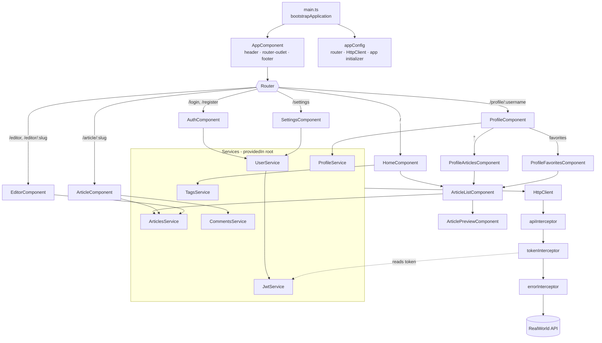
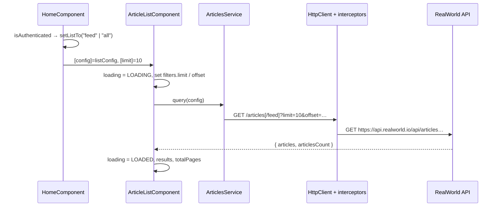
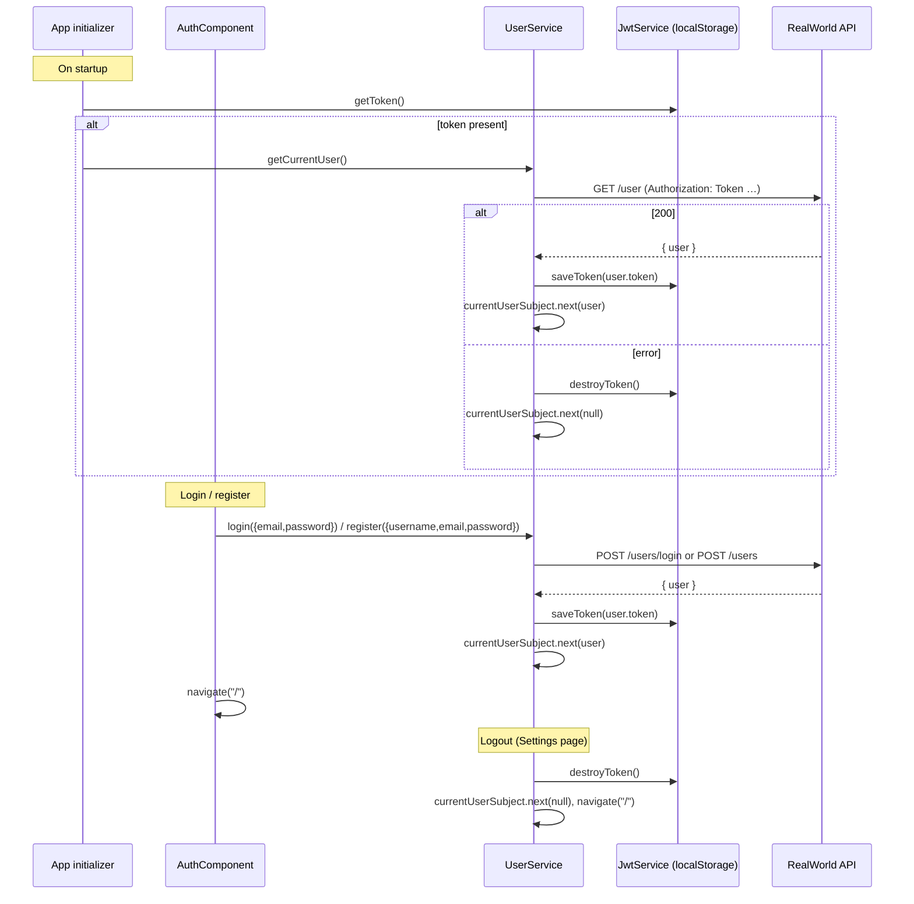

# Architecture

This document describes how the Conduit Angular frontend is put together: the component/service map, how data flows from the API to the UI, how authentication works, and what each HTTP interceptor does. Everything here reflects the code under `src/app/`.

## High-level overview

- **Angular 20, standalone APIs only.** `src/main.ts` calls `bootstrapApplication(AppComponent, appConfig)`. There are no NgModules; each component lists its dependencies in `imports`.
- **Application providers** live in `src/app/app.config.ts`:
  - `provideRouter(routes)`
  - `provideHttpClient(withInterceptors([apiInterceptor, tokenInterceptor, errorInterceptor]))`
  - `provideAppInitializer(...)` — restores the logged-in user on startup
- **Lazy loading.** Every page is loaded on demand via `loadComponent` (or `loadChildren` for the profile routes). Page components are `export default` classes so they can be imported directly by the router.
- **Zone.js change detection.** `zone.js` is included as a polyfill. A few purely presentational components (`FooterComponent`, `ArticleMetaComponent`) use `ChangeDetectionStrategy.OnPush`.



## Directory and responsibility map

### `core/` — app-wide singletons and shell

| File                                 | Responsibility                                                                                                                         |
| ------------------------------------ | -------------------------------------------------------------------------------------------------------------------------------------- |
| `auth/auth.component.ts`             | Sign in / sign up page. Reads the last URL segment (`login` or `register`) to decide mode; adds a `username` control for registration. |
| `auth/services/jwt.service.ts`       | `getToken` / `saveToken` / `destroyToken` on `window.localStorage["jwtToken"]`.                                                        |
| `auth/services/user.service.ts`      | Current-user state (`BehaviorSubject<User \| null>`), `login`, `register`, `logout`, `getCurrentUser`, `update`.                       |
| `auth/if-authenticated.directive.ts` | `*ifAuthenticated="true \| false"` structural directive that renders its template based on auth state.                                 |
| `auth/user.model.ts`                 | `User { email, token, username, bio, image }`.                                                                                         |
| `interceptors/*.ts`                  | Functional HTTP interceptors (see [Interceptors](#http-interceptors)).                                                                 |
| `layout/header.component.*`          | Navigation bar; different links for logged-in / logged-out users; shows current user's avatar and name.                                |
| `layout/footer.component.*`          | Static footer (OnPush).                                                                                                                |
| `models/errors.model.ts`             | `Errors { errors: { [key]: string } }` — shape of RealWorld validation errors.                                                         |
| `models/loading-state.model.ts`      | `LoadingState` enum: `NOT_LOADED`, `LOADING`, `LOADED`.                                                                                |

### `features/article/`

| File                                      | Responsibility                                                                                                      |
| ----------------------------------------- | ------------------------------------------------------------------------------------------------------------------- |
| `pages/home/home.component.*`             | Feed tabs (Your Feed / Global Feed / tag), popular tags sidebar (rendered with RxAngular `*rxLet`).                 |
| `pages/article/article.component.*`       | Article view: Markdown body, meta, follow/favorite buttons, delete (author only), comment form and list.            |
| `pages/editor/editor.component.*`         | Title / description / body / tags form for creating articles; loads an existing article for `/editor/:slug`.        |
| `components/article-list.component.ts`    | Given an `ArticleListConfig` and `limit`, queries articles, tracks `LoadingState`, renders previews and pagination. |
| `components/article-preview.component.ts` | Card for one article in a list, with a favorite button.                                                             |
| `components/article-meta.component.ts`    | Author avatar/name/date block (OnPush) with content projection for action buttons.                                  |
| `components/article-comment.component.ts` | Single comment; shows a delete icon when the current user is the author.                                            |
| `components/favorite-button.component.ts` | Toggles favorite; redirects anonymous users to `/register`.                                                         |
| `services/articles.service.ts`            | `query`, `get`, `create`, `update`, `delete`, `favorite`, `unfavorite`.                                             |
| `services/comments.service.ts`            | `getAll`, `add`, `delete`.                                                                                          |
| `services/tags.service.ts`                | `getAll`.                                                                                                           |
| `models/*.ts`                             | `Article`, `Comment`, `ArticleListConfig { type, filters: { tag, author, favorited, limit, offset } }`.             |

### `features/profile/`

| File                                        | Responsibility                                                                             |
| ------------------------------------------- | ------------------------------------------------------------------------------------------ |
| `profile.routes.ts`                         | `:username` → `ProfileComponent` with children `''` (articles) and `favorites`.            |
| `pages/profile/profile.component.*`         | Loads the profile, determines if it is the current user, hosts a nested `<router-outlet>`. |
| `components/profile-articles.component.ts`  | Article list filtered by `author`.                                                         |
| `components/profile-favorites.component.ts` | Article list filtered by `favorited`.                                                      |
| `components/follow-button.component.ts`     | Follow/unfollow; redirects anonymous users to `/login`.                                    |
| `services/profile.service.ts`               | `get`, `follow`, `unfollow`.                                                               |

### `features/settings/` and `shared/`

| File                                        | Responsibility                                                                              |
| ------------------------------------------- | ------------------------------------------------------------------------------------------- |
| `features/settings/settings.component.*`    | Update image, username, bio, email, password; logout button.                                |
| `shared/components/list-errors.component.*` | Renders an `Errors` object as a list of `"<field> <message>"` strings.                      |
| `shared/pipes/markdown.pipe.ts`             | Async pipe: lazy-imports `marked`, parses Markdown, sanitizes the HTML with `DomSanitizer`. |

## Routing

Top-level routes (`src/app/app.routes.ts`) use inline functional guards that inject `UserService`:

| Path                     | Loaded                               | `canActivate`                        |
| ------------------------ | ------------------------------------ | ------------------------------------ |
| `''`                     | `HomeComponent`                      | —                                    |
| `login`, `register`      | `AuthComponent`                      | `isAuthenticated.pipe(map(a => !a))` |
| `settings`               | `SettingsComponent`                  | `isAuthenticated`                    |
| `profile`                | `profile.routes.ts` (`loadChildren`) | —                                    |
| `editor`, `editor/:slug` | `EditorComponent`                    | `isAuthenticated`                    |
| `article/:slug`          | `ArticleComponent`                   | —                                    |

The router uses the default path location strategy (no `#`), which is why static hosting needs the SPA fallback in `src/_redirects`.

## Data flow

Services are thin wrappers around `HttpClient`, `providedIn: "root"`, and unwrap the RealWorld response envelope (`{ article }`, `{ comments }`, `{ profile }`, …) with `map`. Components subscribe (usually with `takeUntilDestroyed(this.destroyRef)`) and store results in plain fields; templates use the built-in control flow (`@if`, `@for`).

Example — loading the home feed:



- `ArticleListConfig.type === "feed"` hits `/articles/feed`; anything else hits `/articles` with `tag`, `author` or `favorited` filters as query params.
- Clicking a page number calls `setPageTo(n)`, which recomputes `offset` and re-queries.
- Favorite/follow buttons call the API and emit an `@Output() toggle`; the parent updates its local model (e.g. `favoritesCount`).

### State

There is no global store. The only shared state is the current user in `UserService`:

```ts
private currentUserSubject = new BehaviorSubject<User | null>(null);
public currentUser = this.currentUserSubject.asObservable().pipe(distinctUntilChanged());
public isAuthenticated = this.currentUser.pipe(map((user) => !!user));
```

Anything that needs auth state (guards, header, `*ifAuthenticated`, home feed selection, article/comment ownership checks) derives it from these observables.

## Authentication flow



- The token is stored under the `jwtToken` key in `localStorage`.
- Validation errors from login/register come back as `{ errors: { … } }` (see the error interceptor) and are shown via `<app-list-errors>`.

## HTTP interceptors

Registered in order in `app.config.ts`. Each is an `HttpInterceptorFn`.

1. **`apiInterceptor`** (`core/interceptors/api.interceptor.ts`) — rewrites every request URL to `https://api.realworld.io/api${req.url}`. This is the single place the backend base URL is configured.
2. **`tokenInterceptor`** (`core/interceptors/token.interceptor.ts`) — injects `JwtService` and, if a token exists, sets `Authorization: Token <jwt>` (the RealWorld spec uses the `Token` scheme, not `Bearer`).
3. **`errorInterceptor`** (`core/interceptors/error.interceptor.ts`) — `catchError((err) => throwError(() => err.error))`, so subscribers receive the response body (e.g. `{ errors: { email: ["is invalid"] } }`) instead of an `HttpErrorResponse`.

## Rendering details

- **Markdown**: `MarkdownPipe` is an async pipe (`article.body | markdown | async`) that dynamically imports `marked` (split into its own lazy chunk) and sanitizes the output with `DomSanitizer.sanitize(SecurityContext.HTML, …)`.
- **RxAngular**: `@rx-angular/template`'s `RxLet` is used on the home page (`*rxLet="tags$; let tags"`) to render the tag list.
- **Styles**: the global Conduit theme is loaded from `//demo.productionready.io/main.css` in `index.html`; components add only small local styles.

## Known gaps in the current code

These were observed while documenting and are listed so contributors aren't surprised:

- `EditorComponent.submitForm()` always calls `ArticlesService.create(...)`, even when editing an existing article at `/editor/:slug`; `ArticlesService.update(...)` exists but is not used.
- `SettingsComponent.ngOnInit()` passes the `Observable` returned by `UserService.getCurrentUser()` to `settingsForm.patchValue(...)`, so the form is not pre-filled with the current user's values.
- There are no unit tests (`*.spec.ts`) and no lint builder configured — see [DEVELOPMENT.md](DEVELOPMENT.md).
