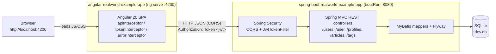

# Full-Stack Local Setup: Angular Conduit + Spring Boot RealWorld API

> **This repo:** `angular-realworld-example-app` (frontend). The same guide lives in [`spring-boot-realworld-example-app`](https://github.com/Samir-Chaudhry-Enterprise/spring-boot-realworld-example-app/blob/master/docs/FULL_STACK.md) (backend).

This guide explains how to run the [Angular 20 Conduit frontend](https://github.com/Samir-Chaudhry-Enterprise/angular-realworld-example-app) against the [Spring Boot RealWorld API backend](https://github.com/Samir-Chaudhry-Enterprise/spring-boot-realworld-example-app) on your machine. Everything below was verified end-to-end locally (register, log in, create an article, view it) without changing application code; the only edits are local, uncommitted configuration tweaks called out explicitly.

## Architecture overview

The Angular app is a static single-page application served by the Angular CLI dev server. All data comes from the Spring Boot REST API, which persists to a local SQLite file via MyBatis. The two processes run independently on different ports, so every API call from the browser is a cross-origin request.



| Concern      | Frontend (Angular)                                                                                   | Backend (Spring Boot)                                                                            |
| ------------ | ---------------------------------------------------------------------------------------------------- | ------------------------------------------------------------------------------------------------ |
| Port         | `4200` (Angular CLI default, `ng serve`)                                                             | `8080` (Spring Boot default; no `server.port` override)                                          |
| API base URL | Hardcoded in `src/app/core/interceptors/api.interceptor.ts` (default `https://api.realworld.io/api`) | Served from the root: `http://localhost:8080` (**no `/api` prefix**)                             |
| Auth         | JWT kept in `localStorage["jwtToken"]`, sent as `Authorization: Token <jwt>`                         | `JwtTokenFilter` validates HS512 JWT; secret in `application.properties`                         |
| Storage      | n/a                                                                                                  | SQLite file `dev.db` in the backend repo root (gitignored; Flyway creates the schema on startup) |
| GraphQL      | not used                                                                                             | Also available at `/graphql` (and GraphiQL at `/graphiql`); the Angular app only uses REST       |

## Prerequisites

| Tool              | Version                                                                      | Source                                                                                                                                         |
| ----------------- | ---------------------------------------------------------------------------- | ---------------------------------------------------------------------------------------------------------------------------------------------- |
| Node.js           | `^20.19.0`, `^22.12.0`, or `>=24.0.0`                                        | `engines` in the frontend `package.json` (verified with Node 24.19.0)                                                                          |
| npm (or Yarn 1.x) | npm 10+ / Yarn 1.22                                                          | ships with Node / frontend README recommends Yarn                                                                                              |
| JDK               | 11 (what the backend targets: `sourceCompatibility = '11'`, CI uses Zulu 11) | backend `build.gradle`, `.github/workflows/gradle.yml`. JDK 17 also works with the bundled Gradle 7.4 wrapper (verified with OpenJDK 17.0.19). |
| Gradle            | none to install, use `./gradlew` (Gradle 7.4)                                | backend `gradle/wrapper/gradle-wrapper.properties`                                                                                             |
| Git               | any                                                                          |                                                                                                                                                |

Clone both repositories side by side:

```bash
git clone https://github.com/Samir-Chaudhry-Enterprise/spring-boot-realworld-example-app.git
git clone https://github.com/Samir-Chaudhry-Enterprise/angular-realworld-example-app.git
```

## Step 1: Start the backend (Spring Boot)

```bash
cd spring-boot-realworld-example-app
./gradlew bootRun
```

Wait for `Tomcat started on port(s): 8080 (http)` and `Started RealWorldApplication`. On first start Flyway creates `dev.db` and applies `V1__create_tables.sql`.

Smoke test:

```bash
curl http://localhost:8080/tags
# {"tags":[]}
```

Notes:

- The API lives at the root, `http://localhost:8080`, **not** `http://localhost:8080/api`.
- Data persists across restarts in `dev.db`. To start from an empty database, stop the app and run `./gradlew clean` (the `clean` task deletes `dev.db`) or delete `dev.db` manually.
- To use a different port, run `./gradlew bootRun --args='--server.port=8081'` and use that port in the frontend API URL below.

## Step 2: Point the frontend at the local backend

The frontend has no environment files and no dev-server proxy. The API base URL is hardcoded in one place, the functional HTTP interceptor `src/app/core/interceptors/api.interceptor.ts`, which prefixes every relative request URL (`/users`, `/articles`, ...):

```ts
// src/app/core/interceptors/api.interceptor.ts (as committed)
export const apiInterceptor: HttpInterceptorFn = (req, next) => {
  const apiReq = req.clone({ url: `https://api.realworld.io/api${req.url}` });
  return next(apiReq);
};
```

For local development, change the prefix to the Spring Boot root URL (no `/api`, no trailing slash):

```ts
const apiReq = req.clone({ url: `http://localhost:8080${req.url}` });
```

Or as a one-liner from the frontend repo root:

```bash
sed -i.bak 's#https://api.realworld.io/api#http://localhost:8080#' src/app/core/interceptors/api.interceptor.ts && rm src/app/core/interceptors/api.interceptor.ts.bak
```

This is a local-only change; do not commit it. `git diff` will show it, and `git checkout -- src/app/core/interceptors/api.interceptor.ts` reverts it. If you want Git to ignore it while you work, use `git update-index --skip-worktree src/app/core/interceptors/api.interceptor.ts` (undo with `--no-skip-worktree`).

> Why not a proxy? `ng serve --proxy-config` only proxies relative URLs. Because the interceptor rewrites every request to an absolute URL, a proxy config has no effect unless the interceptor is also changed. Pointing the interceptor straight at `http://localhost:8080` works because the backend already allows CORS from any origin (see below).

### Optional: fix the missing Conduit stylesheet

`src/index.html` loads the Conduit theme from `//demo.productionready.io/main.css`, which currently returns **404**. The app still works but renders as unstyled HTML. For a styled local UI, you can swap that `<link>` (again, locally only) for the stylesheet published in the RealWorld repo:

```html
<link rel="stylesheet" href="https://cdn.jsdelivr.net/gh/gothinkster/realworld@main/assets/theme/styles.css" />
```

## Step 3: Start the frontend (Angular)

```bash
cd angular-realworld-example-app
npm install --legacy-peer-deps   # or: yarn install
npm start                        # runs `ng serve` on http://localhost:4200
```

`npm install` without `--legacy-peer-deps` fails with `ERESOLVE`: `@rx-angular/cdk@18.0.0` / `@rx-angular/template@18.0.0` declare a peer dependency on `@angular/core@^18.0.0`, while the repo uses Angular 20. The flag (or Yarn 1.x, which only warns on peer conflicts) installs the pinned versions, and the app builds and runs normally. There is no committed lockfile, so this creates a local `package-lock.json` / `yarn.lock`; don't commit it unless you intend to.

`npm install` also runs the `prepare` script (`husky install`), which installs the repo's Husky pre-commit hook (`npx lint-staged` -> `prettier --write` on staged `*.{ts,html,css,json,md}` files).

Open http://localhost:4200.

## CORS

CORS is configured in the backend in `src/main/java/io/spring/api/security/WebSecurityConfig.java` (`corsConfigurationSource()`), registered for `/**`:

| Setting           | Value                                               |
| ----------------- | --------------------------------------------------- |
| Allowed origins   | `*` (any origin, including `http://localhost:4200`) |
| Allowed methods   | `HEAD, GET, POST, PUT, DELETE, PATCH`               |
| Allowed headers   | `Authorization`, `Cache-Control`, `Content-Type`    |
| Allow credentials | `false` (no cookies; auth is a header)              |

Spring Security permits all `OPTIONS` requests, so browser preflights succeed without a token. Verified preflight:

```bash
curl -i -X OPTIONS http://localhost:8080/users \
  -H "Origin: http://localhost:4200" \
  -H "Access-Control-Request-Method: POST" \
  -H "Access-Control-Request-Headers: content-type,authorization"
# HTTP/1.1 200
# Access-Control-Allow-Origin: *
# Access-Control-Allow-Methods: HEAD,GET,POST,PUT,DELETE,PATCH
# Access-Control-Allow-Headers: content-type, authorization
```

No CORS change is needed to run the two apps locally. Things to keep in mind:

- A request with any **other** custom header (for example `X-Requested-With`) fails preflight with `403 Invalid CORS request`. Add it to `setAllowedHeaders(...)` if the frontend ever sends one.
- If you lock origins down (for example `setAllowedOrigins(asList("http://localhost:4200"))`) remember to include every origin/port you serve the frontend from.
- Because `allowCredentials` is `false`, the wildcard origin is valid. If you switch to cookie auth and set it to `true`, you must list explicit origins instead of `*`.

## Auth / JWT flow

```mermaid
sequenceDiagram
    participant U as User (browser)
    participant A as Angular (UserService, JwtService, interceptors)
    participant S as Spring Boot (JwtTokenFilter, UsersApi, CurrentUserApi)
    participant D as SQLite

    U->>A: Submit /register or /login form
    A->>S: POST /users or POST /users/login  {"user":{...}}
    S->>D: insert user / look up by email, check BCrypt hash
    S-->>A: 201/200 {"user":{email, username, bio, image, token}}
    A->>A: JwtService.saveToken(token) -> localStorage["jwtToken"]
    Note over A: tokenInterceptor adds "Authorization: Token <jwt>" to every request
    A->>S: GET /user, POST /articles, ...
    S->>S: JwtTokenFilter: split header on " ", verify HS512 signature + exp, load user by id (sub)
    S-->>A: 200 (or 401 if no/invalid token on a protected route)
    Note over A: On app start, appConfig initAuth calls GET /user if a token exists; on error purgeAuth() clears it
```

Details that matter when connecting the two:

- **Request/response envelope.** Bodies are wrapped in a root key (`{"user": {...}}`, `{"article": {...}}`). The backend enables `spring.jackson.deserialization.UNWRAP_ROOT_VALUE=true`, and the Angular services send exactly this shape.
- **Header scheme.** Angular sends `Authorization: Token <jwt>` (RealWorld convention). `JwtTokenFilter` just takes the second whitespace-separated part of the header, so `Bearer <jwt>` also works (useful for curl/Postman).
- **Token contents.** HS512, `sub` = user id (UUID), `exp` = now + `jwt.sessionTime` (86400 s = 24 h). Signing key: `jwt.secret` in the backend `application.properties`. Override it for anything beyond local dev, e.g. `./gradlew bootRun --args='--jwt.secret=<long-random-string>'`.
- **Stateless.** No session or cookie; `SessionCreationPolicy.STATELESS`. Logout is purely client-side (Angular removes `jwtToken` from `localStorage`).
- **Public vs. protected routes** (`WebSecurityConfig`): `POST /users`, `POST /users/login`, `GET /articles/**`, `GET /profiles/**`, `GET /tags`, `OPTIONS *`, `/graphql`, `/graphiql` are public; `GET /articles/feed` and everything else require a valid token. An invalid token on a public `GET` is ignored rather than rejected.
- **Token survives backend restarts** (static secret), but if you delete `dev.db` the user id in the token no longer exists: `GET /user` returns 401 and the frontend silently logs you out on the next page load.

## Verifying the setup

With both apps running:

1. **API reachable:** `curl http://localhost:8080/tags` returns `{"tags":[]}` (or your tags).
2. **Register:** open http://localhost:4200/register, create a user. You land on the home page with your username in the header. DevTools -> Application -> Local Storage -> `http://localhost:4200` shows a `jwtToken`.
3. **Log out / log in:** Settings -> "Or click here to logout.", then Sign in with the same email and password.
4. **Create an article:** New Article -> fill title, description, markdown body, a tag (press Enter) -> Publish Article. You are redirected to `/article/<slug>` with the rendered markdown.
5. **View it:** Home -> Global Feed lists the article and Popular Tags shows your tag.

In DevTools -> Network you should see requests to `http://localhost:8080/...` (not `api.realworld.io`), for example:

```text
POST http://localhost:8080/users            -> 201
GET  http://localhost:8080/user             -> 200
POST http://localhost:8080/users/login      -> 200
POST http://localhost:8080/articles/        -> 200
GET  http://localhost:8080/articles/<slug>  -> 200
GET  http://localhost:8080/articles?limit=10&offset=0 -> 200
```

Equivalent API-only check with curl:

```bash
TOKEN=$(curl -s -X POST http://localhost:8080/users -H 'Content-Type: application/json' \
  -d '{"user":{"username":"jane","email":"jane@example.com","password":"password123"}}' \
  | python3 -c 'import sys,json; print(json.load(sys.stdin)["user"]["token"])')
curl -s http://localhost:8080/user -H "Authorization: Token $TOKEN"
curl -s -X POST http://localhost:8080/articles -H "Authorization: Token $TOKEN" -H 'Content-Type: application/json' \
  -d '{"article":{"title":"Hello","description":"desc","body":"# Hi","tagList":["demo"]}}'
```

## Troubleshooting

| Symptom                                                                                                                      | Cause                                                                                                                                                                         | Fix                                                                                                                                                                                                  |
| ---------------------------------------------------------------------------------------------------------------------------- | ----------------------------------------------------------------------------------------------------------------------------------------------------------------------------- | ---------------------------------------------------------------------------------------------------------------------------------------------------------------------------------------------------- |
| Frontend loads but no articles/tags, Network tab shows requests to `api.realworld.io` failing (HTTP 530 / DNS / CORS errors) | Interceptor still points at the public demo API, which is no longer available                                                                                                 | Change `api.interceptor.ts` to `http://localhost:8080` (Step 2) and let `ng serve` rebuild                                                                                                           |
| Every request returns **401**, even `GET /tags`                                                                              | API URL includes `/api` (e.g. `http://localhost:8080/api`). Unknown paths fall through to Spring Security's `anyRequest().authenticated()`, so they return 401 instead of 404 | Use `http://localhost:8080` with no `/api` suffix                                                                                                                                                    |
| Browser console: `net::ERR_CONNECTION_REFUSED` on `localhost:8080`                                                           | Backend not running or on a different port                                                                                                                                    | Start `./gradlew bootRun`; match the port in the interceptor                                                                                                                                         |
| `npm install` fails with `ERESOLVE ... peer @angular/core@"^18.0.0" from @rx-angular/cdk@18.0.0`                             | Rx Angular 18 peer range vs Angular 20                                                                                                                                        | `npm install --legacy-peer-deps` or `yarn install`                                                                                                                                                   |
| `npm start` warns about Node version / fails to start                                                                        | Node outside `^20.19.0 \|\| ^22.12.0 \|\| >=24.0.0`                                                                                                                           | Switch Node version (e.g. `nvm use 22`)                                                                                                                                                              |
| App works but looks like plain unstyled HTML                                                                                 | `//demo.productionready.io/main.css` returns 404                                                                                                                              | Optional local swap of the stylesheet `<link>` (Step 2)                                                                                                                                              |
| Avatars show as broken images                                                                                                | Backend default avatar `image.default=https://static.productionready.io/images/smiley-cyrus.jpg` returns 404                                                                  | Cosmetic only. Set an avatar URL in Settings, or override `--image.default=<url>` when starting the backend                                                                                          |
| Publishing an article shows `title article name exists` (HTTP 422)                                                           | Slugs are derived from the title and must be unique                                                                                                                           | Use a different title                                                                                                                                                                                |
| Sign up shows `email duplicated email` / `username duplicated username` (422)                                                | User already exists in `dev.db`                                                                                                                                               | Sign in instead, or reset with `./gradlew clean`                                                                                                                                                     |
| Logged out unexpectedly after restarting the backend                                                                         | `dev.db` was deleted/reset, so the user in the stored JWT no longer exists (`GET /user` -> 401)                                                                               | Register again                                                                                                                                                                                       |
| Preflight fails with `403 Invalid CORS request`                                                                              | Request sends a header not in `Authorization, Cache-Control, Content-Type`                                                                                                    | Add the header to `setAllowedHeaders` in `WebSecurityConfig`                                                                                                                                         |
| `./gradlew bootRun` fails resolving dependencies with `Received status code 429 from server: Too Many Requests`              | Maven Central rate-limiting your IP (seen on shared CI/cloud IPs)                                                                                                             | Retry later, or add a user-level mirror in `~/.gradle/init.d/` (for example Google's Maven Central mirror `https://maven-central.storage-download.googleapis.com/maven2/`) without touching the repo |
| `Port 8080 was already in use` / `Port 4200 is already in use`                                                               | Another process on the port                                                                                                                                                   | Stop it, or run on another port (`--args='--server.port=8081'`, `ng serve --port 4300`) and update the API URL accordingly                                                                           |

## Links

- Frontend: https://github.com/Samir-Chaudhry-Enterprise/angular-realworld-example-app
- Backend: https://github.com/Samir-Chaudhry-Enterprise/spring-boot-realworld-example-app
- RealWorld API spec: https://realworld-docs.netlify.app/specifications/backend/introduction/
